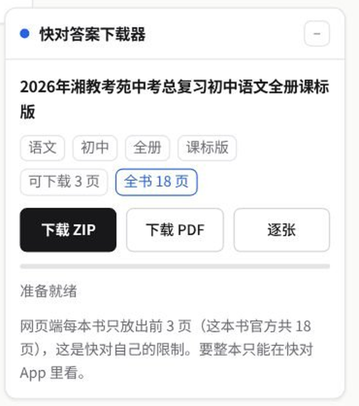
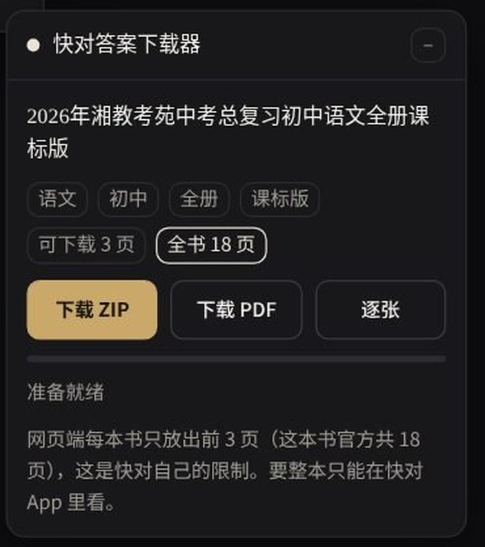

# 快对答案下载器 · Kuaidui Answer Downloader

在浏览器里一键保存快对的教辅答案解析，导出 ZIP / PDF / 逐张图片；另附 App 侧整本抓取脚本。

<p align="center">
  
  
</p>

**特性**

- **零依赖**：整个扩展 34 KB，没有第三方包、没有远程脚本，ZIP 打包和 JPEG→PDF 都是自己写的
- **两种形态**：页面内浮层面板（单本 / 批量）、工具栏弹窗（关键词搜书 + 勾选下载）
- **两套皮**：浅色「极简白」/ 深色「深色高级」，跟随系统，也可手动切换，改 `tokens.css` 一个文件全套生效
- **不 eval**：MV3 禁止执行远端代码，所以自己写了个只认「JSON 子集 + 形参引用」的 Nuxt 数据解析器
- **整本答案（两种）**：① **一次性取密钥**——任意能跑快对的设备 hook 一次拿到 `secret_md5`+`cuid`，填进插件，之后纯浏览器签名，整本直接下，不再需要设备；② 常驻本地桥——设备一直开着时面板走桥实时签
- **附赠 App 侧脚本**：Frida 抓包 + adb 截图两条路，用来导出网页端拿不到的整本答案

> **先说清楚能力边界**：快对网页端对每本书只放出**前 3 页**答案原图（实测 20 本，全书 4~76 页的都只给 3 页），这是服务端就不下发，不是插件限制。整本要走 App 那一侧，见 [② App 抓包](#-app-抓包整本答案)。

---

## 四种方式

把「快对」上的教辅答案解析保存成本地图片 / PDF。按需要选：

| 方式 | 能拿到什么 | 需要什么 | 清晰度 |
|---|---|---|---|
| **① 浏览器插件**（`extension/`） | 每本书的前 3 页原图；能按关键词批量搜书、批量下载 | Chrome / Edge | 原图 1480×2176 |
| **② App 抓包**（`app/`） | **整本全部页**原图 | 设备已 root（Waydroid / 真机）+ frida | 原图 |
| **③ adb 截图**（`app/kd_shots.py`） | App 里翻到的每一页 | 只要能连 adb | 屏幕分辨率 |
| **④ 本机桥**（`app/kd_bridge_server.py`） | **整本全部页**，直接在浏览器面板里点「下载全书」 | root + frida（真机/Waydroid） | 原图 |

> 为什么要分三种：快对网页端每本书只放出前 3 页答案原图（页面数据里 `answerCount` 会写明全书多少页，但 `oriAnswers` 只给 3 条）。整本答案在 App 里，而 App 的请求带 native 签名，硬复刻接口不划算——所以方式②干脆坐在 App 里面，让它自己去请求，顺手把结果接住。

---

## ① 浏览器插件

### 安装

不想自己打包的话，直接下现成的：[**Releases → kuaidui-downloader-extension.zip**](https://github.com/junxi8686/kuaidui-downloader/releases/latest/download/kuaidui-downloader-extension.zip)，解压后按下面第 3 步加载。

1. 打开 `chrome://extensions/`（Edge 是 `edge://extensions/`）
2. 右上角打开「开发者模式」
3. 点「加载已解压的扩展程序」，选这个 `extension/` 目录
4. 装好后图标出现在工具栏

### 用法

**单本下载**——打开任意一本书的答案页（地址形如 `https://m.kuaiduizuoye.com/bookid<32位>`），右下角会出现面板：

- `下载 ZIP`：原图 + `信息.txt` 打包成一个压缩包
- `下载 PDF`：合成 A4 PDF，每页一张图
- `逐张`：交给浏览器逐个下载

**批量**——两种入口：

- 搜索结果页 / 收藏页上直接用右下角面板的「批量 ZIP」，会把本页所有书一次抓完
- 点插件图标，输入书名关键词搜索，勾选书目后批量下载

**图片质量**在弹窗里选：原图 / 2400 / 1600 / 1200（数字是宽度像素，走 CDN 的缩放参数）。

### 输出

下载目录下 `快对答案/`：

```
快对答案/
├─ 2026年湘教考苑中考总复习初中语文全册课标版 语文/
│  ├─ 答案_第01页.jpg
│  ├─ 答案_第02页.jpg
│  ├─ 答案_第03页.jpg
│  └─ 信息.txt
└─ 2026年湘教考苑中考总复习初中语文全册课标版 语文.pdf
```

### 实现要点

- **不用 eval 解析 `window.__NUXT__`**：MV3 禁止执行远端代码，所以 `src/lib.js` 里手写了一个只认「JSON 子集 + 形参引用」的解析器——Nuxt 会把长字符串提成形参（`name:i` 这种），必须把形参表和实参表对上才能还原书名/年级。
- **ZIP / PDF 都是自己写的**：`src/zip.js`（store 模式 + CRC32）、`src/pdf.js`（JPEG 直嵌 `/DCTDecode`），零第三方依赖，整个扩展 ~40KB，没有供应链问题。
- **图片在后台 service worker 里取**，带 `host_permissions`，不受页面 CORS 限制；4 并发 + 重试。
- 站点对无 UA 的请求会回 `"OK"`（反爬），请求里带了浏览器 UA。
- 面板 UI 走 shadow DOM，不会和快对页面样式打架。

### 外观：浅色 / 深色

一套 `tokens.css` 管两套皮：

| | 浅色（极简白） | 深色（深色高级） |
|---|---|---|
| 底 / 卡片 | `#FAFAF9` / `#FFFFFF` | `#0E0E10` / `#18181B` |
| 文字 / 次要 | `#18181B` / `#6B6B73` | `#F2EFE9` / `#A19C93` |
| 主色 | `#18181B`（按钮黑底白字） | `#C9A86A`（香槟金按钮深字） |
| 点缀 / 链接 | `#2563EB` | `#E8E2D6` / `#C9A86A` |
| 圆角 / 阴影 | 10px / `0 1px 2px rgba(24,24,27,.06)` | 12px / `0 12px 40px rgba(0,0,0,.45)` |
| 标题字体 | 无衬线 600、字距 -0.02em | 宋体 500、字距 +0.01em |

- 默认跟随系统 `prefers-color-scheme`；
- 想手动固定：点面板左上角那个小圆点，循环「跟随系统 → 浅色 → 深色」，选择会存下来，弹窗也跟着变；
- 改风格只动 `extension/src/tokens.css` 一个文件，面板和弹窗一起变。

| 浅色 | 深色 |
|---|---|
|  |  |

---

## ② App 抓包（整本答案）

思路：**不复刻签名，让 App 自己发请求。** 插件挂在 fastjson / gson / org.json 的解析入口上，App 一解出整本答案的 JSON，就顺手抄一份图片直链。

### 准备（Waydroid）

```bash
# 1. 开 adb（宿主机）
sudo waydroid shell setprop service.adb.tcp.port 5555
sudo waydroid shell stop adbd && sudo waydroid shell start adbd
adb connect <WAYDROID_IP>:5555        # IP 见 waydroid status

# 2. 客户端
pip install frida-tools
```

真机则是：开发者选项开 USB 调试，Magisk / KernelSU 给 `su` 授权。

### 跑

```bash
cd kuaidui-downloader/app
chmod +x run_capture.sh
./run_capture.sh kd_capture.log
```

脚本会自动：认架构 → 下载对应 `frida-server` → 推进 `/data/local/tmp` → 起服务 → 启动快对并注入。

然后在设备上：

1. 打开要下载的那本书 → 查看答案
2. 从第 1 页翻到最后一页（慢慢翻一遍就行，不用每页停留）
3. 终端里出现 `[KD] {"bookId":...}` 就是抓到了，Ctrl+C 结束

### 导出

```bash
python3 kd_export.py --log kd_capture.log --pdf
python3 kd_export.py --log kd_capture.log --pdf --merge   # 多本合并成一个 PDF
python3 kd_export.py --log kd_capture.log --list          # 只看看抓到了哪些书
```

输出到 `~/下载/快对答案/<书名>/`，加 `--pdf` 同时生成同名 PDF。

### 没有 root 的兜底

```bash
python3 kd_shots.py --out ~/下载/快对答案截图 --pages 40 --pdf
```

先手动把 App 停在答案第 1 页，回车开始，脚本自动上滑翻页 + 截图 + 拼 PDF。截图会去重（翻到底自动停），清晰度是屏幕分辨率。方向不对时加 `--dy -0.6` 反向翻。

---

## ④ 整本答案：一次取密钥，之后纯浏览器

`sign` 的公式是 `md5("8&%d*[" + md5(SECRET) + "]@" + 参数串)` —— **只用 SECRET 的 md5**。
所以不需要一直开着设备：从任意一台能跑快对的机器上 hook 一次，拿到 `secret_md5`（32 位 hex）和 `cuid`，
填进插件，之后签名全在浏览器里完成。

```bash
# 设备侧（Waydroid / 真机，root + frida）
frida -U -f com.kuaiduizuoye.scan -l app/kd_bridge.js

# 本机
pip install frida
python3 app/kd_bridge_server.py --port 8710
python3 app/kd_secret.py          # 打印 secret_md5 + cuid，并写 token.json
```

```
secret_md5 : 3f2a……（32 位 hex）
cuid       : ……
```

把这两个值填进插件弹窗（「整本答案 · 本地密钥」→ 保存）。然后打开任意书本页，
面板会多出 **「下载全书（N 页 · 本地签名）」**——点它就下整本，**不再需要设备、不需要桥、不需要 App**。

> 密钥与设备绑定：换设备/重装 App 后 `secret_md5` 会变，重跑一次 `kd_secret.py` 即可。

## ⑤ 本机桥：设备一直开着时实时签

App 的接口是 `POST https://www.kuaiduizuoye.com/kdtools/book/downloadanswer?bookId=…&pageNo=…`，
要 `sign`（antispam 令牌 + native 签名）。纯浏览器算不出来——所以换个思路：**让 App 自己签**。

组件：

```
设备(快对App) ←frida→ kd_bridge_server.py (127.0.0.1:8710) ←fetch→ 浏览器插件
```

步骤：

```bash
# 1) 设备侧：起 frida-server，注入桥
frida -U -f com.kuaiduizuoye.scan -l app/kd_bridge.js

# 2) 本机：起本地桥（CORS 全开，只监听 127.0.0.1）
pip install frida
python3 app/kd_bridge_server.py --port 8710

# 3) 浏览器：刷新快对书本页，面板会自动探测 /health，
#    就绪后多出「下载全书（N 页 · 走本机 App）」，点它即可
```

也可以用命令行一步导出整本：

```bash
python3 app/kd_full.py --book <bookId> --bridge http://127.0.0.1:8710 --out ~/下载/快对答案 --pdf
```

桥的协议（`/health` `/init` `/sign` `/sign_raw` `/downloadanswer`）写在
[app/REVERSE.md](app/REVERSE.md) §7；签名算法逆到了第 2 层，`app/kd_sign.py` / `app/kd_sign.js`
是已复刻的部分，第 3 层（antispam 的 SECRET）要设备来做——原因见下。

### 逆向到什么程度了

| 层 | 内容 | 状态 |
|---|---|---|
| host / path / 方法 | `www.kuaiduizuoye.com` + `/kdtools/book/downloadanswer` + **POST** | ✅ 实测打通（之前 404 是 host 错 + 用了 GET） |
| 参数串 | `Base64(排序后的 k=v 用 & 连接)` | ✅ Python / JS 逐字节一致 |
| sign 主体 | `md5("8&%d*[" + md5(SECRET) + "]@" + paramString)` | ✅ 从 `nativeGetSign`（0x1054）反汇编得出 |
| SECRET | `nativeInitBaseUtil → POST /pluto/app/antispam → nativeSetToken` | ⚠️ 设备侧 hook 一次即可；纯离线造不出来 |
| antispam blob | 8 字节分组 ECB / PKCS5，密钥 `@fG2SuLA` | ⚠️ **不是标准 DES**（实测 `E("AAAAAAAA")=036114e86c6052bb`），静态硬啃不划算 |

**结论**：完全零设备地在本地造出 antispam blob 不划算（那套分组密码是改过的），
但只需要 **一次** 设备介入换到 `secret_md5`，之后就是纯浏览器。

所以现在没有「纯浏览器复刻签名」这条路：**要么用桥让 App 签，要么就没有整本**。细节和证据都在
[app/REVERSE.md](app/REVERSE.md)。

## 目录结构

```
kuaidui-downloader/
├─ extension/                 浏览器插件（Chrome/Edge，MV3）
│  ├─ manifest.json
│  ├─ icons/                 16/48/128 图标
│  └─ src/
│     ├─ tokens.css          设计变量（浅色极简白 / 深色深色高级）
│     ├─ panel.css           页面内面板样式
│     ├─ popup.css           弹窗样式
│     ├─ lib.js              Nuxt 数据解析（无 eval）
│     ├─ zip.js              ZIP 打包（store + CRC32）
│     ├─ pdf.js              JPEG → PDF
│     ├─ background.js       抓页面、取原图、打包、下载
│     ├─ content.js          页面内浮动面板 + 外观切换
│     └─ popup.html/js       弹窗：搜书 + 批量
├─ app/                       整本答案（App 侧）
│  ├─ REVERSE.md             接口逆向报告：host/path/签名分层/证据
│  ├─ kd_full.py             CLI：按 bookId 导出整本（--mode web / --bridge）
│  ├─ kd_sign.py / kd_sign.js 已复刻的两层签名（含浏览器可用的 KdBridge 客户端）
│  ├─ kd_bridge_server.py    本地桥：把 App 的签名能力暴露成 HTTP
│  ├─ kd_bridge.js           frida 脚本：给桥提供签名与请求
│  ├─ kd_secret.py           一次性取 secret_md5 + cuid（填进插件用）
│  ├─ kd_native_emu.py       unicorn 模拟 libbaseutil.so（研究用）
│  ├─ kd_capture.js          frida 脚本：抄 App 的 JSON（另一条路）
│  ├─ kd_export.py           抓包日志 → 图片 / PDF
│  ├─ run_capture.sh         一键部署 frida-server 并注入
│  └─ kd_shots.py            adb 截图兜底
├─ tests/
│  ├─ harness.js             在 node 里模拟 chrome.*，真跑一遍后台逻辑
│  ├─ bookid….html           插件面板的浏览器预览页
│  └─ popup-demo.html        弹窗预览页
├─ docs/                     浅色 / 深色截图
└─ README.md
```

## 验证过的东西

- `tests/harness.js zip` / `pdf` / `multi` / `search`：在 node 里 stub 掉 `chrome.*`，对着**真实快对页面**跑完整条链路——解析书名年级、抓 3 页原图（489KB / 654KB / 588KB）、打 ZIP、合成 PDF（`pdfinfo` 校验：A4、页数对、中文标题不乱码）。
- `tests/bookid….html`：无头浏览器打开，面板渲染、解析、按钮状态都正常。
- `tests/popup-demo.html`：弹窗列表、勾选、计数渲染正常。

## 为什么只有 3 页（重要）

**这是快对网页端自己的限制，不是插件的上限。**

实测 20 本书（全书 4 / 10 / 12 / 18 / 28 / 36 / 47 / 76 页不等），网页端每一本都只给 **3 条** `oriAnswers`——连全书只有 4 页的书也只给 3 页。数据里 `answerCount` 写明全书多少页，图片却只有 3 张，剩下的是服务端根本不下发。

验证方式（都可以自己复核）：

```bash
# 1) 网页数据里到底给了几张图
curl -s "https://m.kuaiduizuoye.com/bookid<32位ID>" | grep -o 'oriAnswers:\[[^]]*\]'

# 2) 在真实浏览器里打开这本书，看 XHR —— 答案是一次性 SSR 下发的，
#    翻页/点「查看全部解析」都不会再发请求（只会拉起 App）
```

所以：

| 需求 | 能做到吗 |
|---|---|
| 每本书前 3 页原图 | ✅ 插件 |
| 整本 18 页 | ❌ 浏览器里没有这个数据，只能走 App 那一侧（`app/` 目录） |

### 1.0.0 的一个 bug（1.0.1 已修）

旧版只抓到「封面 + 第 1 页」两张。原因：从首页点进书详情时是 SPA 路由切换，页面里没有服务端注入的 `__NUXT__`，而 DOM 上只渲染了封面和第 1 页缩略图 —— 插件读到 2 张就收工了。

1.0.1 起：只要在书本页，**无论页面里有没有 `__NUXT__`，都会向后台要一次服务端渲染的页面**，以 `oriAnswers` 为准，并把封面从结果里剔掉。`tests/bookid1111…aaaa.html` 就是这个场景的回归测试页。

## 排错

| 现象 | 原因 / 处理 |
|---|---|
| 面板显示「当前页面没有识别到书籍」 | 网址里得带 `bookid<32位>`；搜索页请用批量入口 |
| 面板显示「可下载 0 页」 | 插件会自动向服务端再取一次；还取不到多半是触发了风控，等几分钟再来 |
| 批量时只读到几本 | 站点限流，一次别勾太多（≤20 本），中间隔几分钟 |
| `run_capture.sh` 卡在找设备 | adb 没通。Waydroid 按上面三条命令开 adbd；真机看 `adb devices` 是否有 `device` |
| frida 报 `unable to connect` | `frida-server` 没跑起来：`adb shell ps -A \| grep frida`，或手动 `adb push` + `adb shell su -c /data/local/tmp/frida-server` |
| 抓不到 `[KD]` 行 | App 版本换了 JSON 库。先跑一遍看有没有 `[KD] 快对答案抓取已挂上`，有的话在 App 里把答案页多翻几页；仍没有就把 `kd_capture.js` 里的 hook 换到 okhttp 响应体（脚本里已带兜底，1.5 秒后自动挂） |
| 面板没有「下载全书」按钮 | 桥没连上：`curl http://127.0.0.1:8710/health` 看返回；`ready:false` 说明 App 还没完成 antispam 握手，在 App 里随便打开一本书再回来 |
| 桥报 `errNo 6 / 7` | 令牌过期或 App 版本变了，重启 `kd_bridge.js` 再试 |
| ZIP 里中文名在旧解压工具里乱码 | 文件头已置 UTF-8 标志位，用 7-Zip / 系统自带解压 / macOS 归档工具打开就是正常的 |

## 边界说明

- 插件的下载全在你本机完成，不经过任何第三方服务器，不读取账号密码。
- 抓包脚本只读响应，不改 App、不上传数据；`frida-server` 用完建议关掉。
- 网页端只有前 3 页是官方设定，不是插件的问题——要整本走方式 ②。

---

## 声明

- 插件只把**你浏览器里已经显示的内容**存到本地下载目录：不碰账号密码、不绕验证码、不上传任何数据到第三方服务器。
- 下载到的答案解析版权归原出版社 / 快对所有，仅供个人学习核对使用，不要二次分发或商用。
- 站点结构随时会变（改版、加接口参数、换 CDN），插件失效欢迎开 issue；`lib.js` 的解析逻辑是独立的一层，改版时只动它。

## License

[MIT](LICENSE)
