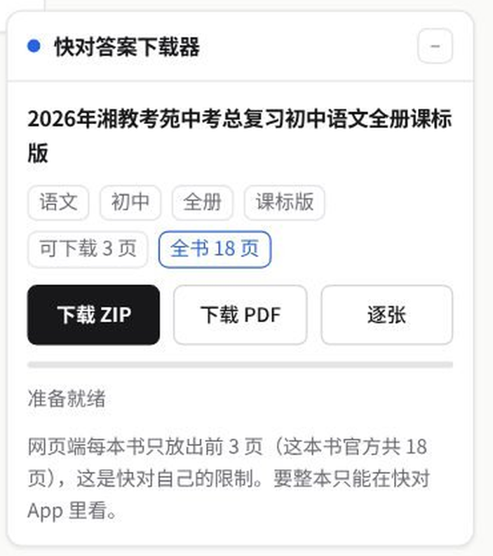
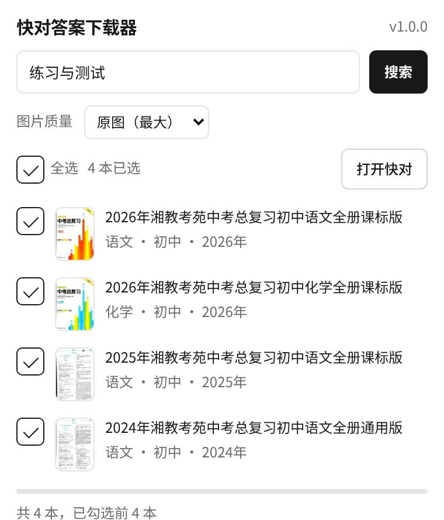

# 快对答案下载器 · 使用说明

> 只用浏览器，不装任何 App、不用手机、不用注册开发者账号。

---

## 一、需要什么

就三样，都是现成的：

| 需要 | 说明 |
|---|---|
| **Chrome 或 Edge 浏览器** | 版本 102 以上（2022 年之后的都行）。360/QQ 浏览器如果支持「扩展程序」也能装，但没测过 |
| **这个文件夹** | `kuaidui-downloader/extension/`，或者 `快对答案下载器-extension.zip` 解压出来的那个 |
| **能上快对** | 能打开 `kuaiduizuoye.com` 就行，不登录也能用 |

不用装 Python、不用装 frida、不用命令行。**装好插件后，全程就是点鼠标。**

---

## 二、安装（第一次，3 步，1 分钟）

### 第 1 步：打开扩展管理页

在地址栏输入（直接复制粘贴）：

```
chrome://extensions/
```

Edge 浏览器用：

```
edge://extensions/
```

### 第 2 步：打开「开发者模式」

页面**右上角**有个开关叫「开发者模式」，把它打开。打开后页面顶部会多出三个按钮。

### 第 3 步：加载文件夹

点左上角出现的 **「加载已解压的扩展程序」** → 在弹出的选择框里找到并选中 `extension` 这个文件夹 → 点「选择文件夹」。

> ⚠️ 选的是 `extension` 文件夹**本身**，不是里面的 `src`。选对了的话，文件夹里能看到 `manifest.json`。

装好后：工具栏右上角出现一个蓝色下载箭头图标，扩展列表里出现「快对答案下载器 1.0.0」。

**装完就不用管它了，以后一直有效。**

---

## 三、怎么用

### 用法 A：下载一本书的答案（最常用）

1. 浏览器打开快对：https://www.kuaiduizuoye.com/
2. 在搜索框输入书名，比如「练习与测试」「五年中考三年模拟」
3. 在结果里点开目标那本书 —— 地址会变成 `.../bookid` 开头的一串
4. **看页面右下角**，会浮出一个小黑面板：

   

5. 面板上有三个按钮，点哪个都行：
   - **下载 ZIP** —— 答案原图 + 一个说明文件，打包成一个压缩包（推荐，一次到位）
   - **下载 PDF** —— 直接合成一个 A4 的 PDF，手机上看、打印都方便
   - **逐张** —— 一张一张存到下载文件夹里

6. 等几秒，浏览器下载栏出现文件，**完事**。

面板上那行小字的意思：
- `可下载 3 页` = 这次能下到几页
- `全书 18 页` = 这本书官方一共有多少页答案

### 用法 B：一次下载很多本（搜一个系列）

1. 打开快对，搜一个系列名（比如「练习与测试」）
2. **停在搜索结果页**，不要点进任何一本
3. 右下角面板会显示「本页检测到 20 本书」
4. 点 **「批量 ZIP」** —— 它会把本页所有书的答案都抓下来，按书名分好文件夹装进一个压缩包

> 一次别超 20 本，抓完歇几分钟再抓下一批，站点有频率限制。

### 用法 C：在插件弹窗里搜书 + 勾选下载

1. 点工具栏上的蓝色图标
2. 输入关键词 → 点「搜索」
3. 列表里勾选要的书（默认全勾）→ 点「批量 ZIP」

   

4. 「图片质量」那一栏：默认**原图（最大）**，就是 1480×2176 的原始清晰度；嫌文件大可以选 1600 或 1200。

---

### 用法 D：下载整本（需要本机跑着快对 App）

网页端每本只有 3 页，整本要靠 App 的签名。如果你愿意开一次 App：

1. 电脑上跑起本地桥（一条命令，见 [README 的 ④ 本机桥](README.md#-本机桥让浏览器用上-app-的签名)）
2. 回到快对书本页刷新一下
3. 面板底部会多出一个黑按钮 **「下载全书（18 页 · 走本机 App）」**，点它就行

没装桥的话这个按钮不会出现，其它功能不受影响。

## 四、文件下到哪了

浏览器默认下载目录下的 `快对答案/` 文件夹里：

```
下载/快对答案/
├─ 2026年湘教考苑中考总复习初中语文全册课标版 语文.zip     ← 用法 A
└─ 快对答案_20261121_1546.zip                         ← 用法 B/C（里面按书分文件夹）
```

解压后的样子：

```
2026年湘教考苑中考总复习初中语文全册课标版 语文/
├─ 答案_第01页.jpg
├─ 答案_第02页.jpg
├─ 答案_第03页.jpg
└─ 信息.txt          ← 书名、学科、年级、官方页数、下载时间、来源链接
```

> 压缩包里的中文文件名是 UTF-8 编码。WinRAR 老版本可能显示乱码，用 **7-Zip / Windows 自带解压 / 双击打开** 都正常。

---

## 五、有件事得先说清楚

**快对网页版对每本书只放出前 3 页答案。**

这不是插件的问题 —— 网页的原始数据里就只给了 3 张图（数据里写着这本书一共 18 页，但图片只有 3 张）。我抽查了 8 本书，全是一样：3 页。

所以：

| 你要的 | 能不能用这个插件 |
|---|---|
| 抓前几页答案、或者一次抓很多本的前 3 页 | ✅ 完全够用，这就是它的强项 |
| 把某一本 18 页答案整本下载 | ❌ 浏览器里做不到，得走快对 App |

整本那条路要手机 + 抓包（`app/` 目录里那套，需要 root），你说没有安卓版，那就先不折腾。**如果哪天你只需要某本教辅的后几页**，最省事的办法是在 App 里翻到那页截图，或者告诉我具体是哪本，我看看有没有别的路子。

---

## 六、常见问题

**Q：右下角没有面板怎么办？**
A：① 确认网址里带 `bookid` 这串（搜索结果页、书详情页才有）；② 刷新一下页面；③ 到 `chrome://extensions/` 确认插件是「已启用」状态，点一下插件上的刷新按钮。

**Q：面板显示「可下载 0 页」？**
A：页面刚跳转、数据还没加载完，等两秒；还不行就刷新。偶尔是站点限流，停几分钟再来。

**Q：为什么只抓到「封面 + 第 1 页」，后面的没有？**
A：这是 1.0.0 的 bug，1.0.1 已修（表现：从首页点进书详情后，页面里读不到完整数据，只扫到了页面上那两张图）。换新版后重装一次即可，面板会显示「可下载 3 页」，封面不会再混进去。

**Q：面板上找不到「下载全书」按钮？**
A：那个按钮只在本地桥连上时才出现。先 `curl http://127.0.0.1:8710/health`，返回里 `ready:true` 才算就绪；`ready:false` 就在 App 里随便打开一本书，再刷新网页。

**Q：为什么永远只有 3 页？**
A：快对网页端对每本书只放出前 3 页答案原图，全书几十页也一样只给 3 张——这是它服务端就不下发，跟插件无关。我实测了 20 本书，全部是 3 页。整本答案只能在快对 App 里看。

**Q：点了下载没反应？**
A：看浏览器右上角下载图标有没有转圈；再到 `chrome://downloads/` 看有没有被拦。ZIP 一般 2~5 MB，十几秒内应该出现。

**Q：会不会要我登录 / 要手机号？**
A：不用。插件只读页面上已经显示的内容，不碰账号、不要密码，下载全在本机完成，不经过任何第三方服务器。

**Q：换电脑了怎么办？**
A：把 `extension` 文件夹拷过去，按上面「安装」三步重做一遍就行。也可以打包成 zip 存网盘。

**Q：能不能换成深色 / 浅色？**
A：默认跟随系统。点面板左上角那个小圆点，会在「跟随系统 → 浅色 → 深色」之间循环，选过一次就记住了，弹窗也会跟着变。浅色是白底黑字、蓝点缀；深色是近黑底、香槟金按钮、宋体标题——两套是同一份设计变量，改一处全套一起变。

**Q：更新了代码怎么生效？**
A：到 `chrome://extensions/`，点插件卡片上的 **🔄 刷新** 按钮。
